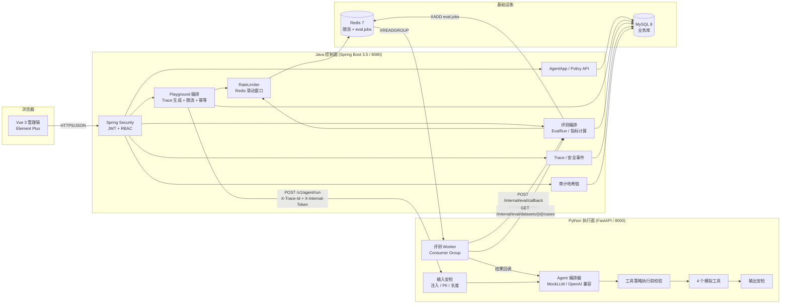
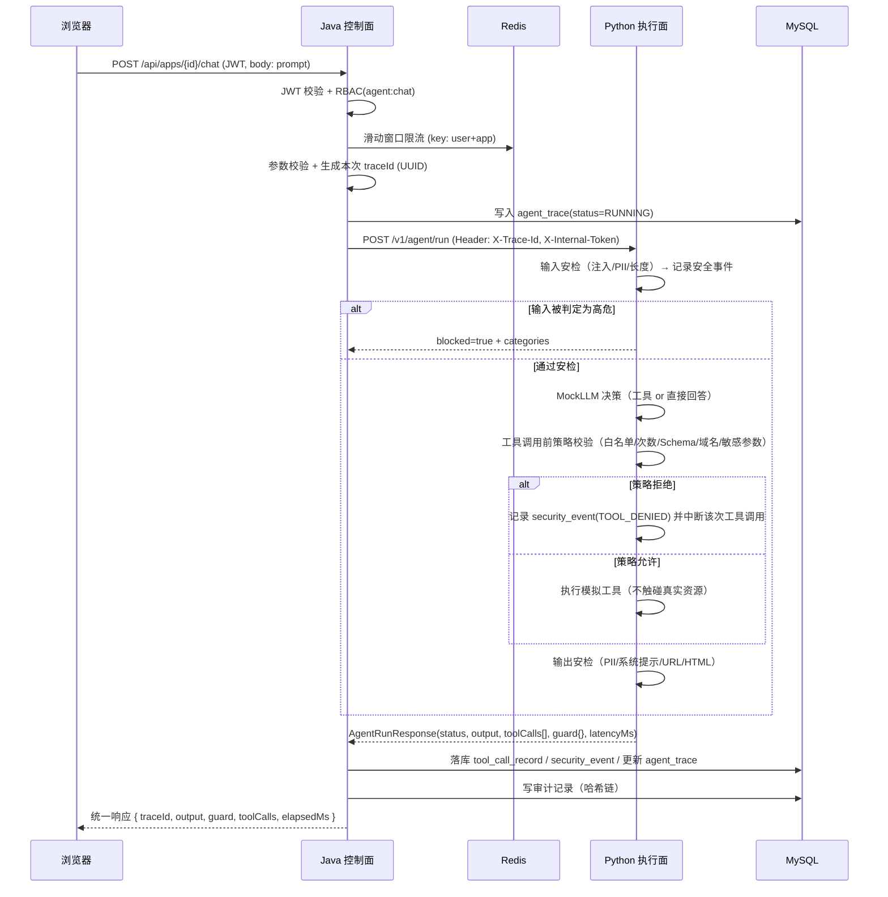
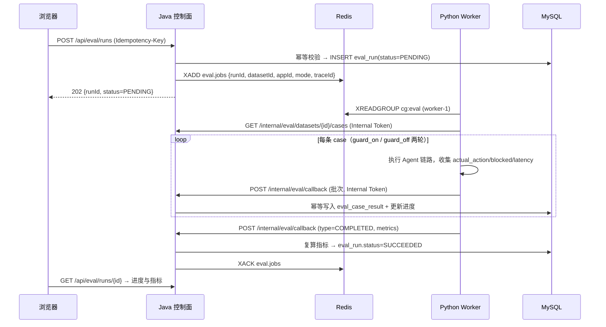
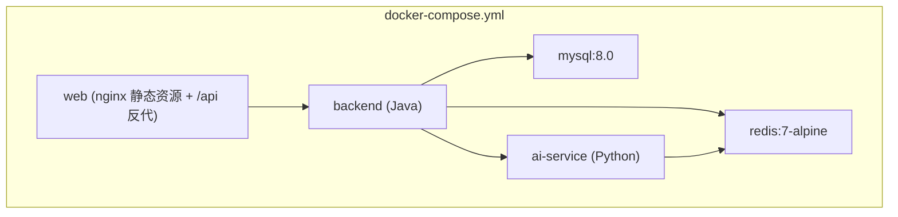

# TrustAgent 架构说明

## 1. 总体架构



## 2. 组件职责

### 2.1 Java 控制面

| 包 / 组件 | 职责 | 关键设计点 |
| --- | --- | --- |
| `io.trustagent.security` | JWT 签发与校验、`UserPrincipal`、`@PreAuthorize` 权限表达式、内部 Token 过滤器 | 无状态认证；内部接口用**独立** Token，不复用用户 JWT |
| `io.trustagent.app` | `AgentApp` / `AgentTool` / `SecurityPolicy` 的 CRUD | 策略以“应用”为单位版本化；工具白名单与策略同表 |
| `io.trustagent.chat` | Playground 编排：认证 → 限流 → 校验 → Trace ID → 调 Python → 落库 | 控制面不执行工具，只下发策略并记录结果 |
| `io.trustagent.gateway.PythonAgentClient` | 调 Python 执行面的 HTTP 客户端 | 超时、Trace ID 透传、错误降级为可审计的失败 Trace |
| `io.trustagent.eval` | 数据集导入校验、EvalRun 生命周期、指标计算、报告导出 | 指标由 Java **独立复算**，对 Python 结果做交叉校验 |
| `io.trustagent.audit` | 审计记录写入与哈希链验证 | `record_hash = SHA256(规范化字段 | prev_hash)` |
| `io.trustagent.ratelimit` | 限流抽象 + Redis 滑动窗口实现 + 内存实现 | 接口化便于测试与替换算法 |
| `io.trustagent.idempotency` | `Idempotency-Key` 幂等 | 唯一索引兜底，重复请求返回同一资源 |

### 2.2 Python 执行面

| 模块 | 职责 |
| --- | --- |
| `app/llm` | `LLMProvider` 抽象；`MockLLMProvider`（默认，确定性）；`OpenAICompatibleProvider`（选配） |
| `app/guardrails` | 统一 `Detector` 接口；`InjectionDetector`、`PiiDetector`、`OutputGuard`、`GuardPipeline` |
| `app/tools` | 工具注册表、参数 JSON Schema 校验、4 个模拟工具、Mock Outbox |
| `app/agent` | 编排器：输入安检 → 决策 → 工具前策略校验 → 执行 → 输出安检 → 组装结果 |
| `app/eval` | Worker：消费 Redis Streams、批量评测、指标计算、回调 Java |
| `app/observability` | 结构化日志、Trace ID 上下文 |

### 2.3 为什么安全判断不能只写在 Prompt 里

Prompt 是**建议**，模型可以不遵守；攻击者也可以诱导模型忽略它。TrustAgent 的做法是：
在工具真正执行的那一行代码之前，由 `ToolPolicyEnforcer` 读取控制面下发的策略对象（不是模型输出）做硬校验。
模型输出只能表达“我想调用某工具”，能不能调用由策略决定。这样即使模型被完全攻陷，被允许的能力上限依然由策略固定。

## 3. 核心数据流

### 3.1 Agent 对话（Playground）



### 3.2 批量评测（阶段2）



### 3.3 幂等与重试的一致性边界

- **Java 侧**：`idempotency_record` 表 `UNIQUE(idem_key, scope)`，先插入后执行；
  唯一键冲突即视为重复请求，直接返回已存在资源 ID。
- **结果写入侧**：`eval_case_result` 表 `UNIQUE(run_id, case_id, guard_enabled)`，
  回调重复到达时执行“存在则跳过”，因此重复消费不会叠加统计。
- **Redis 侧**：`XACK` 只在结果成功写入后发送；Worker 崩溃时消息保留在 PEL，
  由 `XAUTOCLAIM` 重新分配；超过 `maxDeliveries` 进入死信 Stream `eval.jobs.dlq`。

## 4. 跨语言可观测性

- 入口由 Java 生成 `traceId`，写入 MDC 与响应头 `X-Trace-Id`。
- 调 Python 时通过 `X-Trace-Id` 传递，Python 用 `ContextVar` 保存并写入每条结构化日志。
- 所有落库记录（Trace / 工具调用 / 安全事件 / 审计 / 评测）都带 `trace_id`，前端可一键串联。

日志格式统一为单行 JSON 风格键值对，例如：

```
2026-09-15T10:20:30.123Z INFO  traceId=8f1c... appId=3 event=tool.denied tool=send_notification rule=TOOL_NOT_ALLOWED
```

## 5. 部署形态



- 仅 `mysql`、`redis` 暴露端口到宿主机（演示用）；`backend` 与 `ai-service` 只在 compose 网络内互通。
- 内部 Token 通过环境变量注入，不写入镜像。
