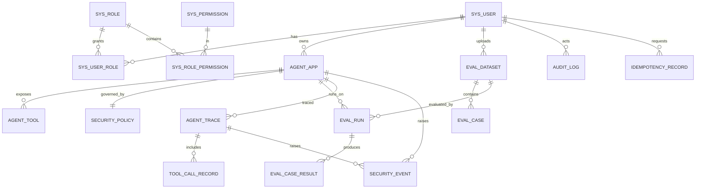

# TrustAgent 数据库设计

- 目标库：**MySQL 8.0**；迁移工具：**Flyway**（`backend/src/main/resources/db/migration`）。
- 迁移脚本同时兼容 H2 2.x（`MODE=MySQL`），以便 `test` / `dev` profile 零外部依赖运行。
  因此脚本中**不使用** MySQL 专有语法：没有 `ENGINE=InnoDB`、没有列级 `COMMENT`、没有内联 `UNIQUE KEY(...)`，
  唯一约束统一写成独立的 `CREATE UNIQUE INDEX`。字符集与引擎在 `docker-compose.yml` 的 MySQL 启动参数中设置。

## 1. ER 图

## 2. 表结构

> 所有表使用 `BIGINT AUTO_INCREMENT` 主键；时间列统一 `TIMESTAMP`（跨 MySQL/H2 兼容，
> 生产若需超过 2038 年可改用 `DATETIME`，语义不变）。

### 2.1 身份与权限

| 表 | 关键列 | 说明 |
| --- | --- | --- |
| `sys_user` | `username`(唯一)、`password_hash`(BCrypt)、`status`(ACTIVE/DISABLED)、`last_login_at` | 账号主体 |
| `sys_role` | `code`(唯一，ADMIN/DEVELOPER/AUDITOR)、`name` | 角色 |
| `sys_permission` | `code`(唯一，如 `app:create`)、`resource`、`action` | 权限点 |
| `sys_user_role` | `user_id`,`role_id`，唯一键 | 用户-角色 |
| `sys_role_permission` | `role_id`,`permission_id`，唯一键 | 角色-权限 |

**为什么拆 4 张表**：权限点（permission）与业务代码里的 `@PreAuthorize("hasAuthority('app:create')")` 一一对应，
角色只是权限的集合。新增角色不需要改代码，只需插数据；越权判定完全由 Spring Security 的 authority 集合决定。

### 2.2 Agent 应用与策略

| 表 | 关键列 | 说明 |
| --- | --- | --- |
| `agent_app` | `code`(唯一)、`name`、`owner_id`、`system_prompt`、`status` | Agent 应用 |
| `agent_tool` | `app_id`+`tool_name`(唯一)、`enabled`、`param_schema`(JSON 文本)、`description` | 该应用允许暴露的工具及其参数 Schema |
| `security_policy` | `app_id`(唯一)、`version`、`guard_enabled`、`max_tool_calls`、`max_input_length`、`task_timeout_ms`、`domain_whitelist`、`denied_param_rules`、`confirm_side_effects`、`injection_detection_enabled`、`pii_masking_enabled`、`output_guard_enabled` | 每应用一份当前生效策略 |

**为什么策略和应用分表**：策略是“安全配置”，会被频繁修改、需要有独立的更新审计（`version` 递增，
每次修改写 `audit_log`）。分开后可以给策略表单独的权限校验（只有 ADMIN 与所属 owner 可改），
也便于未来做策略历史版本表。

**为什么 `param_schema` 存文本而不是 MySQL JSON 类型**：为了让同一份 Flyway 脚本能在 MySQL 与 H2 上执行。
应用层用 Jackson 解析并校验，长度上限与解析异常都会返回 400。

### 2.3 评测

| 表 | 关键列 | 说明 |
| --- | --- | --- |
| `eval_dataset` | `name`、`source_category`（标注合成来源）、`checksum`、`case_count`、`owner_id` | 评测集 |
| `eval_case` | `dataset_id`+`case_id`(唯一)、`category`、`prompt`、`context`、`expected_action`、`expected_tool`、`contains_sensitive_data`、`tags` | 单条用例 |
| `eval_run` | `dataset_id`、`app_id`、`mode`(GUARD_ON/GUARD_OFF/BOTH)、`status`、`total_cases`、`completed_cases`、`failed_cases`、`idempotency_key`(唯一)、`guard_metrics_json`、`baseline_metrics_json` | 评测任务 |
| `eval_case_result` | `run_id`+`case_id`+`guard_enabled`(唯一)、`category`、`expected_action`、`actual_action`、`blocked`、`detected_categories`、`pii_leaked`、`passed`、`latency_ms`、`detail_json` | 单条用例结果 |

**为什么 `eval_case_result` 的唯一键包含 `guard_enabled`**：一次评测要对比“关防护/开防护”两轮，
同一条 case 会产生两条结果。把 `guard_enabled` 放进唯一键后，Redis 消息重复投递时可以用
“已存在则跳过”实现结果写入幂等，不会把统计翻倍。

**为什么指标存两份 JSON**：`guard_metrics_json` 是 Java 复算的权威值，`baseline_metrics_json` 是对照组；
同时 Python 在完成回调里也会带一份自算指标，Java 比对不一致时写安全事件，形成双端交叉校验。

### 2.4 运行时留痕

| 表 | 关键列 | 说明 |
| --- | --- | --- |
| `agent_trace` | `trace_id`(唯一)、`app_id`、`user_id`、`input_preview`、`output_preview`、`guard_decision`、`guard_categories`、`status`、`tool_call_count`、`total_latency_ms` | 一次 Agent 请求的摘要 |
| `tool_call_record` | `trace_id`、`tool_name`、`arguments_masked`、`result_masked`、`allowed`、`deny_reason`、`latency_ms` | 每次工具调用（包含被拒绝的） |
| `security_event` | `trace_id`、`app_id`、`event_type`、`severity`、`detector`、`rule_id`、`evidence_masked`、`action_taken` | 安全事件 |
| `audit_log` | `seq`(唯一)、`actor_id`、`actor_username`、`action`、`resource_type`、`resource_id`、`detail_json`、`trace_id`、`prev_hash`、`record_hash` | 审计哈希链 |
| `idempotency_record` | `idem_key`+`scope`(唯一)、`request_hash`、`resource_type`、`resource_id`、`status`、`expires_at` | 幂等记录 |

### 2.5 不允许保存原始敏感数据的字段（重要）

| 字段 | 允许存 | 禁止存 |
| --- | --- | --- |
| `agent_trace.input_preview` | 截断 + 脱敏后的输入片段（如 `138****8000`） | 原始 Prompt 全量、原始手机号/邮箱/身份证/银行卡/API Key |
| `agent_trace.output_preview` | 截断 + 脱敏后的输出片段 | 原始模型输出全量、系统提示词原文 |
| `tool_call_record.arguments_masked` | 脱敏后的参数 JSON | 原始参数中的敏感值 |
| `tool_call_record.result_masked` | 脱敏后的返回值 | 工具返回的原始敏感值 |
| `security_event.evidence_masked` | 命中片段的脱敏版本 | 命中片段的原文 |
| `audit_log.detail_json` | 规范化后的非敏感字段 | 密码、Token、Prompt 原文 |
| `sys_user.password_hash` | BCrypt 哈希（cost=10） | 明文密码、可逆加密密码 |
| 全部表 | — | `.env` 中的密钥、真实个人数据 |

**原则**：脱敏发生在**写入之前**（Python 检测器 → 返回时即为 `masked` 值，Java 只做二次兜底脱敏）。
数据库里不应该出现需要“事后清理”的原始敏感数据。

## 3. 索引设计

| 索引 | 列 | 类型 | 目的 |
| --- | --- | --- | --- |
| `uk_sys_user_username` | `username` | 唯一 | 登录查询 + 防重名 |
| `uk_sys_role_code` | `code` | 唯一 | 角色编码防重 |
| `uk_sys_permission_code` | `code` | 唯一 | 权限编码防重 |
| `uk_user_role` | `user_id`,`role_id` | 唯一 | 防重复授权 |
| `uk_role_permission` | `role_id`,`permission_id` | 唯一 | 防重复授权 |
| `uk_agent_app_code` | `code` | 唯一 | 应用编码防重（对外稳定标识） |
| `idx_agent_app_owner` | `owner_id` | 普通 | “我的应用”列表 |
| `uk_agent_tool_app_name` | `app_id`,`tool_name` | 唯一 | 同一应用不能重复声明工具 |
| `uk_security_policy_app` | `app_id` | 唯一 | 每应用一份生效策略 |
| `idx_eval_dataset_owner` | `owner_id` | 普通 | 我的评测集 |
| `uk_eval_case_dataset_case` | `dataset_id`,`case_id` | 唯一 | 同一集内用例号唯一（重导入可定位） |
| `idx_eval_case_category` | `category` | 普通 | 按类别统计/筛选 |
| `uk_eval_run_idem` | `idempotency_key` | 唯一 | **幂等兜底**：并发重复提交时由数据库裁决 |
| `idx_eval_run_status` | `status` | 普通 | Worker/前端按状态扫描 |
| `uk_eval_result_run_case_guard` | `run_id`,`case_id`,`guard_enabled` | 唯一 | 回调重复写入幂等 |
| `idx_eval_result_run` | `run_id` | 普通 | 结果列表分页 |
| `uk_agent_trace_trace_id` | `trace_id` | 唯一 | Trace 详情按 ID 直查 |
| `idx_agent_trace_app_created` | `app_id`,`created_at` | 复合 | 按应用看最近 Trace |
| `idx_agent_trace_user_created` | `user_id`,`created_at` | 复合 | 用户维度的历史列表 |
| `idx_tool_call_trace` | `trace_id` | 普通 | Trace 详情聚合工具调用 |
| `idx_security_event_created` | `created_at` | 普通 | 安全事件时间倒序 |
| `idx_security_event_app_type` | `app_id`,`event_type` | 复合 | 按应用+类型筛选与统计 |
| `uk_audit_log_seq` | `seq` | 唯一 | 哈希链顺序遍历的关键 |
| `idx_audit_log_action` | `action` | 普通 | 按动作检索 |
| `idx_audit_log_created` | `created_at` | 普通 | 时间范围检索 |
| `uk_idem_key_scope` | `idem_key`,`scope` | 唯一 | **幂等兜底**（与 `eval_run` 双保险） |
| `idx_idem_expires` | `expires_at` | 普通 | 过期清理任务 |

**索引取舍说明**：不建“所有外键列都加索引”的机械方案。`security_event.app_id` 单列索引被
`(app_id, event_type)` 复合索引的最左前缀覆盖，因此不再单建；`eval_case.prompt` 等大文本列不建索引
（无检索场景，建了只增加写放大）。

## 4. 为什么这样划分（模块化理由）

1. **身份（sys_*）与业务解耦**：权限表是通用结构，未来新增模块只需插入权限点。
2. **配置（agent_app/agent_tool/security_policy）与运行记录（agent_trace/…）分离**：
   配置表是小表、强一致性、频繁读；运行记录是大表、只追加、需要按时间分页。分开后可以独立做归档与分区。
3. **评测结果（eval_case_result）与运行时明细（tool_call_record）分离**：评测是“批量、可重放、要算指标”的场景，
   运行明细是“逐次、要给人看”的场景，查询模式完全不同。
4. **审计（audit_log）独立于业务表**：审计链要求严格顺序与全量可验证，不能被业务表的更新操作干扰。
5. **幂等（idempotency_record）独立**：幂等键是跨业务的横切关注点，独立后可以设置过期清理策略。

## 5. 迁移脚本清单

| 版本 | 文件 | 内容 |
| --- | --- | --- |
| V1 | `V1__baseline.sql` | 全部 17 张表 + 索引 |
| V2 | `V2__seed_roles_permissions.sql` | 三个角色与其权限点（不含任何用户密码） |

演示用户由 `scripts/` 下的初始化脚本创建（密码来自环境变量或脚本参数），
**不写入迁移脚本**，避免“默认弱口令进了版本库”这类常见问题。

## 6. 变更记录

| 日期 | 变更 | 原因 |
| --- | --- | --- |
| 2026-09-15 | 初版 | 阶段0 |
