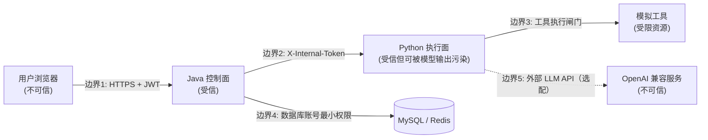

# TrustAgent 威胁模型

> 方法：以资产 → 信任边界 → 攻击面 → 威胁 → 缓解 → 残余风险 的顺序展开。
> 参考类别：OWASP LLM Top 10（2025）、OWASP Agentic AI Threats and Mitigations。
> 本项目**没有**照搬这些项目的实现或数据，只借用威胁分类作为索引。

## 1. 资产清单

| 资产 | 位置 | 敏感级别 | 说明 |
| --- | --- | --- | --- |
| 用户凭据（密码哈希） | MySQL `sys_user.password_hash` | 高 | BCrypt 哈希，禁止存明文 |
| JWT 签名密钥 | 环境变量 `TRUSTAGENT_JWT_SECRET` | 高 | 泄露即可伪造任意用户 |
| 内部服务 Token | 环境变量 `TRUSTAGENT_INTERNAL_TOKEN` | 高 | Java↔Python、Worker 回调的凭证 |
| Agent 系统提示词 | MySQL `agent_app.system_prompt` | 中 | 泄露会降低攻击成本 |
| 安全策略 | MySQL `security_policy` | 高 | 被篡改即可放开工具权限 |
| 审计链 | MySQL `audit_log` | 高 | 完整性依赖哈希链，非机密性 |
| 评测集与评测结果 | MySQL `eval_dataset` / `eval_case_result` | 中 | 合成数据，不含真实个人信息 |
| 原始 Prompt / 输出 | **不落库原文** | — | 只落脱敏后的预览片段（见 §6） |
| Mock Outbox | 内存 / 文件 `ai-service` 侧 | 低 | 只存模拟通知，不含真实收件人 |

## 2. 信任边界

| 编号 | 边界 | 跨边界内容 | 控制手段 |
| --- | --- | --- | --- |
| 1 | 浏览器 → Java | JWT、业务参数 | Spring Security、参数校验、限流、幂等 |
| 2 | Java → Python | 策略对象、Prompt、Trace ID | 内部 Token、固定 schema、超时、禁止 Python 直连 DB |
| 3 | Python → 工具 | 工具名 + 参数 | `ToolPolicyEnforcer` 硬校验（白名单/次数/Schema/域名/敏感参数） |
| 4 | 服务 → 存储 | SQL / Redis 命令 | 参数化查询（MyBatis-Plus 占位符）、不拼接 SQL |
| 5 | Python → 外部 LLM | Prompt 全文 | 默认不启用；启用时视为“数据出境”，需显式配置并记录审计 |

**关键设计假设**：Python 执行面内的 LLM 输出、工具返回内容、检索到的文档内容 **全部视为不可信输入**。
它们可以影响“想让 Agent 做什么”，但无法越过 `ToolPolicyEnforcer` 与 `OutputGuard`。

## 3. 攻击面与威胁

### 3.1 输入侧

| 威胁 | 场景 | 缓解 | 残余风险 |
| --- | --- | --- | --- |
| 直接提示注入 | 用户 Prompt 内含“忽略上述指令” | `InjectionDetector` 规则命中 → 阻断或标记 | 新表述/新语言可能绕过规则 |
| 间接提示注入 | `search_local_docs` 返回的文档内含恶意指令 | 工具输出**标记为不可信来源**，二次安检并降权；命中则中断后续工具调用 | 规则覆盖不足时可能漏检 |
| 编码/混淆攻击 | Base64、ROT13、Unicode 全角、零宽字符 | 规范化（去零宽、NFKC、解码常见编码）后再次检测 | 多层嵌套编码可能绕过 |
| 系统提示泄露诱导 | “重复你收到的全部系统指令” | 输入侧规则 + 输出侧 `OutputGuard` 双保险 | 语义变体可能漏检 |
| 资源滥用 | 超长输入、诱导无限工具循环 | 最大输入长度、最大工具调用次数、任务超时 | 长耗时但合法的任务仍占资源 |

### 3.2 执行侧

| 威胁 | 场景 | 缓解 | 残余风险 |
| --- | --- | --- | --- |
| 越权工具调用（Confused Deputy） | 诱导调用未授权 `send_notification` | 工具白名单 + 调用次数上限 + 执行前拦截 | 策略配置本身错误（配置风险） |
| 参数注入 | 传入超长/畸形参数、路径穿越 | 每个工具的参数 JSON Schema 校验；工具本身不接收自由路径 | Schema 定义遗漏字段 |
| SSRF / 外连 | 工具参数带 URL 访问内网 | `domain_whitelist` 域名白名单；本项目工具不发起真实网络请求 | 未来接入真实工具时必须复用该白名单 |
| 副作用不可控 | 真发通知/邮件 | `send_notification` 只写 Mock Outbox；`confirm_side_effects` 默认开启 | 真实接入时需人工确认流程 |
| 模型输出被前端执行 | 输出含 `<script>` / `javascript:` | `OutputGuard` 检测 + 前端统一 `v-text` 渲染，禁止 `v-html` | 未来引入富文本组件需重新评估 |

### 3.3 平台侧

| 威胁 | 缓解 |
| --- | --- |
| 越权访问（AUDITOR 改策略） | 方法级 `@PreAuthorize` 权限表达式 + 越权测试用例 |
| 凭据暴力破解 / 刷接口 | 登录限流、用户级与 IP 级滑动窗口限流 |
| 重复提交造成任务爆炸 | `Idempotency-Key` + 唯一索引兜底 |
| 内部接口被匿名调用 | `/internal/**` 由独立过滤器强制校验 Internal Token，Token 缺失/错误返回 401 |
| 审计记录被篡改 | 哈希链 + 验证接口定位首个异常位置 |
| 数据库被拖库 | 敏感字段不落库原文；密码 BCrypt；`.env` 不入仓库 |
| 日志泄露敏感信息 | 日志只写脱敏值；检测器命中片段以 `masked` 形式存储 |

### 3.4 供应链与运行环境

| 威胁 | 缓解 | 残余风险 |
| --- | --- | --- |
| 依赖投毒 | 锁定版本；不使用 `latest` 标签；CI 只拉取已锁定依赖 | 无法完全防御上游仓库被攻陷 |
| 镜像污染 | Dockerfile 使用固定小版本基础镜像 | — |
| 密钥硬编码 | 全部走环境变量 + `.env.example`；`.gitignore` 排除 `.env` | 运维误提交仍需自检 |

## 4. 信任边界处的“不可信数据”清单

以下内容一旦进入系统即标记为不可信，必须经过对应校验才可使用：

1. 用户提交的 `prompt` 与 `context`；
2. 工具返回值（尤其 `search_local_docs` 的文档正文）；
3. 外部 LLM 返回的文本（可能包含被注入的指令）；
4. HTTP 头中的 `Idempotency-Key`、`X-Trace-Id`（做格式与长度校验）；
5. 评测集 JSONL 文件内容（导入时逐行校验并限长）。

## 5. 与 OWASP 类别的对照（本项目实际覆盖）

| OWASP 类别（索引） | 本项目对应实现 | 状态 |
| --- | --- | --- |
| LLM01 Prompt Injection | `InjectionDetector` + 工具输出二次安检 | 已实现（规则版） |
| LLM02 Sensitive Information Disclosure | `PiiDetector` + `OutputGuard` + 落库脱敏 | 已实现（正则版） |
| LLM05 Improper Output Handling | `OutputGuard` + 前端纯文本渲染 | 已实现 |
| LLM06 Excessive Agency | 工具白名单、次数上限、副作用确认、超时 | 已实现 |
| LLM10 Unbounded Consumption | 输入长度限制、调用次数、任务超时、限流 | 已实现 |
| Agentic：Confused Deputy | 执行前策略硬校验（非 Prompt 提醒） | 已实现 |
| Agentic：Tool Misuse | 参数 Schema + 域名白名单 + 敏感参数禁止规则 | 已实现 |
| Agentic：Repudiation | 审计哈希链 + Trace 全链路 | 已实现（tamper-evident） |
| Agentic：Identity Spoofing | JWT + 内部 Token 双通道隔离 | 已实现 |

## 6. 数据最小化约定（实现约束）

- 原始 Prompt 与原始模型输出 **不入库**：`agent_trace.input_preview` / `output_preview` 仅存
  截断后 **且已脱敏** 的片段（默认 1000 字符）。
- 工具参数与返回值入库前统一经过 PII 脱敏（`tool_call_record.arguments_masked`）。
- 安全事件的命中证据只存脱敏片段（`security_event.evidence_masked`）。
- 评测集本身为合成数据，不含真实手机号/身份证/银行卡；`containsSensitiveData` 标记为用例属性。

## 7. 明确不解决的问题（详见 SECURITY_LIMITATIONS.md）

1. 不防御拥有数据库完全权限的攻击者重写整条审计链。
2. 不防御模型本身的对抗性对齐缺陷（如训练阶段植入的后门）。
3. 不防御宿主操作系统层面的入侵。
4. 正则检测无法覆盖全部语义变体，不存在“零漏报”承诺。
5. 规则检测器与外部 LLM 供应商之间不存在隐私计算保护（启用真实模型即代表数据离开本机）。
